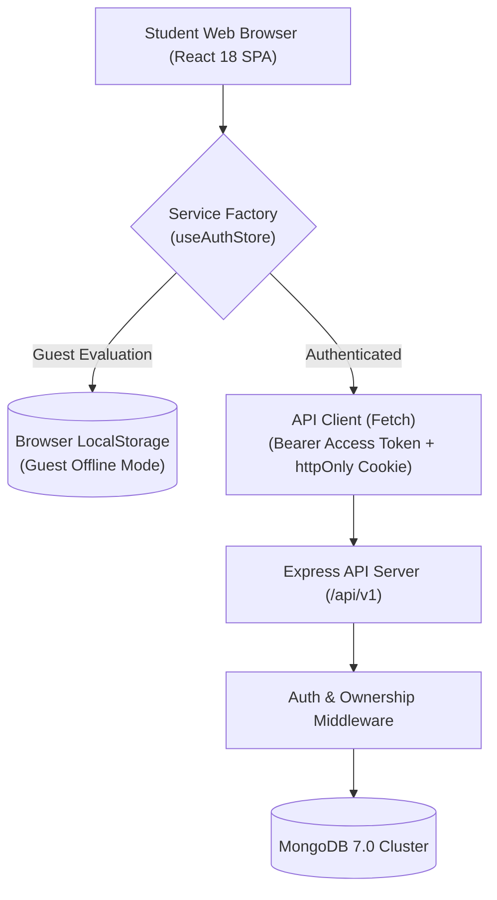

# FocusForge — Student Study Planner & Productivity Workspace

[](https://github.com/FocusForge/FocusForge/actions/workflows/ci.yml)
[](https://nodejs.org)
[](https://www.typescriptlang.org)
[](https://react.dev)
[](https://expressjs.com)
[](https://www.mongodb.com)
[](https://www.w3.org/WAI/standards-guidelines/wcag/)

FocusForge is an opinionated, student-first productivity workspace and study companion. It integrates assignment tracking, Pomodoro focus blocks with background tab timestamp recovery, daily habit tracking with streak mechanics, weekly study goals, interactive calendar planning, and aggregated analytics into a cohesive, distraction-free environment.

FocusForge works **offline-first** as an immediate guest workspace via local storage and seamlessly upgrades to cloud persistence via an authenticated REST API with zero data loss.

---

## Architecture Overview

FocusForge is organized as an npm workspaces monorepo:

```
FocusForge/
├── apps/
│   ├── web/               # React 18 + Vite SPA, Tailwind CSS, TanStack Query, Zustand
│   └── api/               # Express + TypeScript + Mongoose REST API under /api/v1
├── packages/
│   └── shared/            # Shared Zod validation contracts, types, and DTOs
├── docs/
│   ├── architecture.md    # System design, token rotation, and tenant isolation
│   ├── deployment.md      # Step-by-step Atlas, Render, and Vercel guide
│   ├── api.md             # REST API specification with request/response examples
│   ├── testing.md         # Comprehensive testing and QA guide
│   ├── roadmap.md         # Architecture for password recovery and future milestones
│   └── portfolio.md       # Tested resume and portfolio highlights
├── .github/
│   ├── workflows/ci.yml   # Multi-job GitHub Actions CI pipeline
│   └── dependabot.yml     # Automated dependency updates
├── docker-compose.yml     # Full-stack orchestration (MongoDB + API + Web)
└── package.json           # Root workspace configuration
```

### High-Level System Architecture



---

## Key Features

- **Guest / Offline-First Mode:** Instant access with realistic demo data; full feature parity without sign-up.
- **One-Click Cloud Migration:** Seamlessly import local assignments, habits, and study blocks into a newly created account without duplicates.
- **Strict Data Ownership & Tenant Isolation:** Every database query enforces authenticated ownership; unauthorized access attempts return HTTP 404 to prevent user enumeration.
- **Dual-Token Authentication:** 15-minute in-memory access JWTs paired with rotating 7-day `httpOnly`, `SameSite=None`, `secure` refresh cookies and automatic token reuse compromise detection.
- **Timestamp-Based Pomodoro Timer:** Prevents clock drift in sleeping background tabs; persists state across page reloads.
- **Resilient Offline Outbox:** Completed focus sessions are buffered locally if the student loses internet connection and automatically flushed upon reconnection with idempotent deduplication.
- **Zero WCAG AA Violations:** Passed automated Axe-core accessibility audits across all 7 pages in both Dark and Light themes.

---

## Quick Start (Local Development)

### 1. Prerequisites
- **Node.js:** `v20.x` or `v22.x`
- **npm:** `v10.x` or newer
- **Docker** (optional, for local MongoDB container)

### 2. Installation
```bash
# Clone the repository
git clone https://github.com/FocusForge/FocusForge.git
cd FocusForge

# Install all monorepo dependencies
npm install
```

### 3. Environment Setup
```bash
# Backend environment setup
cp apps/api/.env.example apps/api/.env

# Frontend environment setup
cp apps/web/.env.example apps/web/.env
```

### 4. Running the Development Servers
In two separate terminal windows (or using npm workspaces):

```bash
# Terminal 1: Start Backend API (runs on http://localhost:5000)
npm --prefix apps/api run dev

# Terminal 2: Start Frontend Web App (runs on http://localhost:5173)
npm --prefix apps/web run dev
```

---

## One-Command Full Stack via Docker

You can run the entire production-grade stack (MongoDB 7.0 + Express API + Nginx Web SPA) using Docker Compose:

```bash
docker compose up --build
```
- Web Application: `http://localhost:80`
- API Health Endpoint: `http://localhost:5000/health`
- MongoDB Port: `27017`

---

## Testing & Quality Assurance

FocusForge features an extensive test pyramid of **111 automated tests**:

```bash
# Run all unit and integration tests (86 tests)
npm test

# Run frontend tests with coverage
npm --prefix apps/web test -- --coverage

# Run backend API tests with coverage
npm --prefix apps/api test -- --coverage

# Run Playwright E2E browser tests & Axe accessibility audit (25 tests)
npm --prefix apps/web run test:e2e

# Run linter and typecheck
npm run lint
npm run typecheck
```

See [docs/testing.md](docs/testing.md) for full details.

---

## Deployment & Production Runbook

FocusForge is ready for zero-downtime deployment to **Vercel** (Frontend), **Render** (API), and **MongoDB Atlas** (Database).

- **Deployment Runbook:** [DEPLOYMENT_GUIDE.md](DEPLOYMENT_GUIDE.md) | [docs/deployment.md](docs/deployment.md)
- **Architecture Details:** [docs/architecture.md](docs/architecture.md)
- **API Reference:** [docs/api.md](docs/api.md)
- **Future Roadmap:** [docs/roadmap.md](docs/roadmap.md)

---

## Screenshots

| Dashboard (Dark Theme) | Tasks & Filters (Dark Theme) |
| :---: | :---: |
|  |  |

| Focus Timer (Light Theme) | Habit Tracker (Dark Theme) |
| :---: | :---: |
|  |  |

*(Screenshots can be automatically generated by the Playwright E2E test suite)*

---

## License

MIT License. Designed and engineered for students and developers worldwide.
