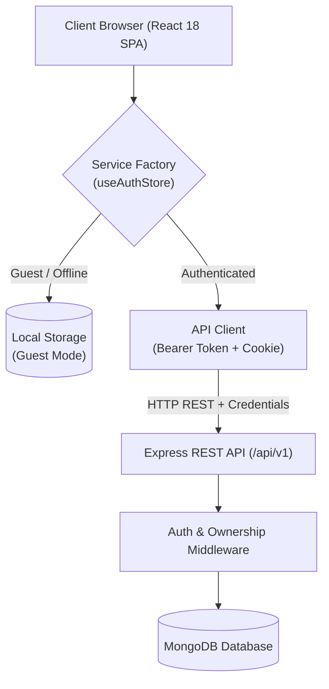

# FocusForge Architecture & Technical Design

This document details the system design, data architecture, security posture, and runtime workflows powering FocusForge.

---

## 1. High-Level System Architecture

FocusForge is built as a three-tier modular monorepo:
1. **Presentation & Application Layer (`apps/web`)**: Client-side Single Page Application (SPA) built with React 18, Vite, TypeScript, and Tailwind CSS.
2. **Domain & Contract Layer (`packages/shared`)**: Shared library housing Zod schemas, TypeScript types, and validation contracts.
3. **API & Persistence Layer (`apps/api`)**: Node.js/Express REST server operating under `/api/v1` backed by MongoDB with strict per-user multi-tenancy.



---

## 2. Authentication & Session Architecture

FocusForge implements an industry-standard **dual-token architecture**:
- **Access Token:** Short-lived (15 minutes) signed JSON Web Token (JWT) kept exclusively in memory. Never persisted to `localStorage` or `sessionStorage` to mitigate Cross-Site Scripting (XSS) risks.
- **Refresh Token:** Long-lived (7 days) cryptographically random string (48 bytes hex) issued in a hardened `httpOnly`, `secure`, `SameSite=None` (or `Lax`) cookie constrained to path `/api/v1/auth`.

### Token Refresh Rotation & Reuse Detection Sequence

```mermaid
sequenceDiagram
    autonumber
    actor User as User Browser
    participant API as Express API
    participant DB as MongoDB

    Note over User,DB: 1. Normal Request with Expired Access Token
    User->>API: GET /api/v1/tasks (Authorization: Bearer <expired>)
    API-->>User: 401 Unauthorized (TOKEN_EXPIRED)

    Note over User,DB: 2. Silent Token Refresh with Rotation
    User->>API: POST /api/v1/auth/refresh (Cookie: focusforge_refresh_token=RT_1)
    API->>DB: Find RefreshToken where hash = SHA256(RT_1)
    alt Token is Valid & Unused
        API->>DB: Mark RT_1 as revoked; Issue RT_2
        API-->>User: 200 OK (New Access Token, Cookie: RT_2)
        User->>API: Re-try original GET /api/v1/tasks (Bearer <new>)
        API-->>User: 200 OK (Tasks payload)
    else Token Reuse Detected (RT_1 already revoked)
        API->>DB: Invalidate ALL active refresh tokens for user (Compromise Protocol)
        API-->>User: 401 Unauthorized (REUSE_DETECTION)
        Note over User: Clear in-memory auth state and redirect to /login
    end
```

---

## 3. Data Isolation & Tenant Ownership Strategy

Every user-owned entity (Tasks, Study Sessions, Focus Sessions, Habits, Habit Completions, Goals, Settings) maintains a strict reference:
```typescript
userId: { type: Schema.Types.ObjectId, ref: 'User', required: true, index: true }
```

### Key Security Guarantees:
1. **Server-Enforced Ownership:** The `userId` is never accepted from the request body or client query string. It is extracted strictly from the verified JWT payload (`req.user.id`).
2. **404 Instead of 403 on Cross-User Access:** If User B attempts to access `/api/v1/tasks/:id` belonging to User A, the query `findOne({ _id: id, userId: req.user.id })` returns `null`, throwing an HTTP 404 (`RESOURCE_NOT_FOUND`). This prevents user enumeration and information leakage.
3. **Compound Indexes:** High-frequency access queries leverage compound indexes:
   - Tasks: `{ userId: 1, status: 1, dueDate: 1 }`
   - Habits: `{ userId: 1, active: 1 }`
   - HabitCompletions: `{ habitId: 1, completedDate: 1 }` (unique)
   - FocusSessions: `{ userId: 1, clientSessionId: 1 }` (unique sparse for idempotent sync)

---

## 4. Swappable Data Layer (Service Factory Pattern)

To support offline-first evaluation without requiring signup, FocusForge uses a **Service Factory Pattern**:

```typescript
// apps/web/src/services/serviceFactory.ts
export function getTaskService(): ITaskService {
  const { status } = useAuthStore.getState();
  return status === 'authenticated' ? apiTaskService : localTaskService;
}
```

- When the user transitions from `guest` to `authenticated` (or logs out), `queryClient.clear()` is called immediately to purge in-memory caches, guaranteeing no cross-account state contamination.
- TanStack Query hooks append `getUserScope()` (`guest` or `usr_<id>`) to all query keys:
  ```typescript
  useQuery({ queryKey: ['tasks', getUserScope(), filters], ... })
  ```

---

## 5. Offline Outbox Pattern for Focus Sessions

Focus timer intervals must never be lost due to network fluctuations.
When a focus session finishes:
1. The session is dispatched via `focusSessionService.create(payload)`.
2. If the user is online, it is persisted directly via `POST /api/v1/focus-sessions`.
3. If the network request fails (or navigator reports offline), the payload is saved to an indexed `focusforge_v1_outbox` in `localStorage` with a UUID `clientSessionId`.
4. A global `window.addEventListener('online', flushOutbox)` triggers automatic retries.
5. The API provides idempotent deduplication: `POST /api/v1/focus-sessions` checks for existing records with the same `(userId, clientSessionId)`, returning the existing document safely without error.
